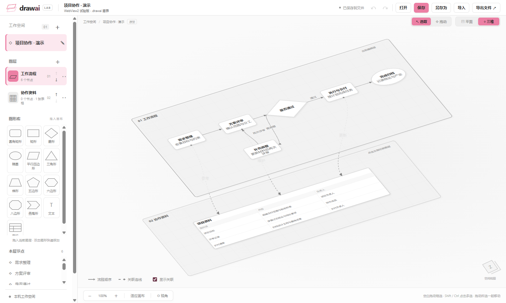
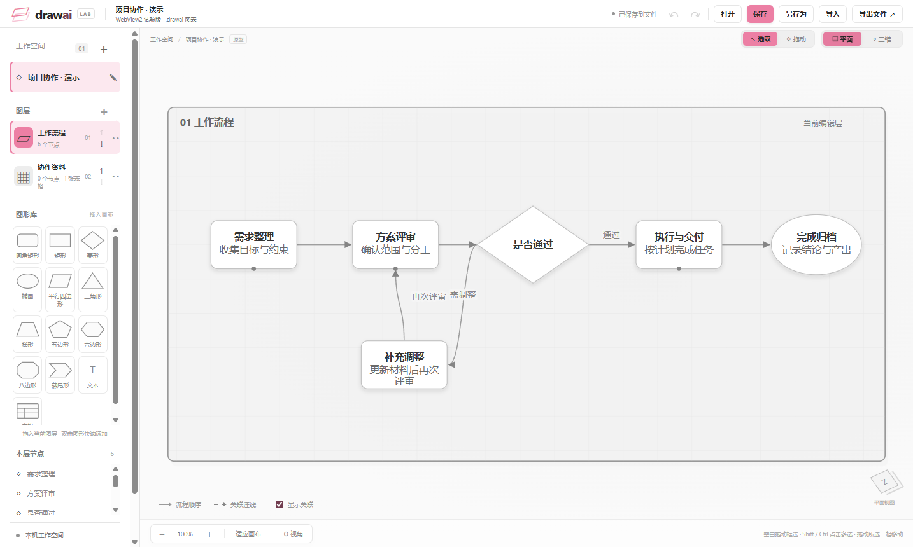
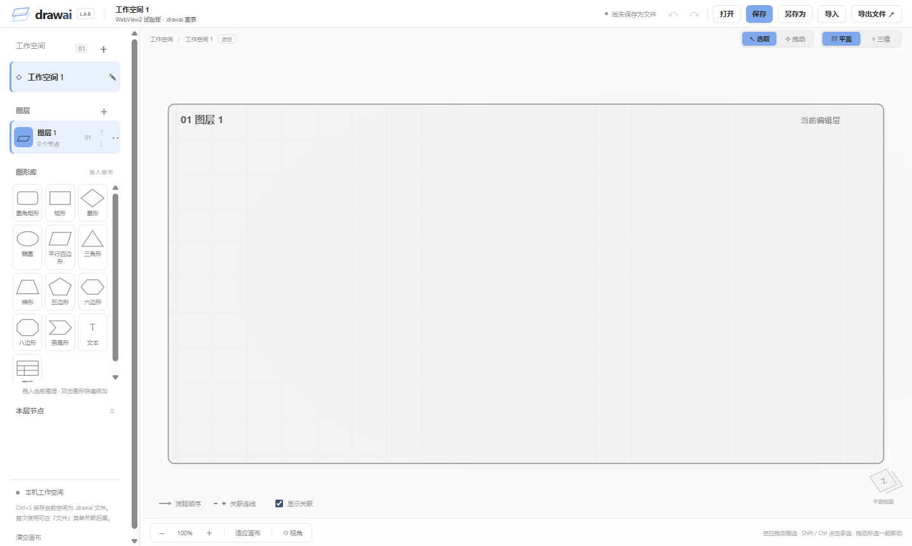

# DrawAI

**可以在平面与三维之间切换的流程图编辑器。** 将流程、表格和资料放在不同图层上，用跨层连线表达关系，再切回平面逐层编辑。

Windows 免安装运行，图表保存在本机，无需登录。默认只有一个空白图层，不附带任何图表，也不包含 AI 模型或远程 Agent 服务。

[下载最新版本](https://github.com/QIU-SHEN/DrawAI/releases/latest) · [反馈问题](https://github.com/QIU-SHEN/DrawAI/issues) · [桌面实现](docs/desktop.md) · [WebView2 实现](docs/webview2.md)

## 预览

三维视图：同时查看多个图层和跨层关联。



平面视图：一次只编辑当前图层。



首次启动是空白画布。顶部原生「主题」菜单可以切换强调色，黑白灰画布保持不变，下图为天空蓝主题。



> 前两张截图使用临时构造的演示内容，仅用于展示操作效果，不随免安装程序分发。

## 下载与运行

| 版本 | 下载 | 适合情况 |
| --- | --- | --- |
| **WebView2 0.4.0（推荐）** | [Windows x64 ZIP，约 378 KiB](https://github.com/QIU-SHEN/DrawAI/releases/download/v0.4.0/DrawAI-WebView2-0.4.0-Windows-x64.zip) | 复用系统 WebView2 Runtime，包体很小 |
| Electron 0.3.0 | [Windows x64 ZIP，约 151 MiB](https://github.com/QIU-SHEN/DrawAI/releases/download/v0.4.0/DrawAI-0.3.0-Windows-x64.zip) | 自带浏览器内核，适合不便准备 WebView2 环境的电脑 |

1. 下载 ZIP，**完整解压**到有写入权限的文件夹。
2. 运行 `DrawAI-WebView2.exe` 或 `DrawAI.exe`。不要只复制 EXE，也不要直接在压缩包里运行。
3. 从左侧图形库拖入图形或表格，开始绘制。
4. 使用「保存」或 `Ctrl+S` 保存为 `.drawai` 文件。
5. 如需双击文件打开，在「文件 → 关联 .drawai 文件」中设置一次。移动程序文件夹后需要重新关联。

WebView2 版需要 Windows 10/11 x64、.NET Framework 4.6.2+ 和 [Microsoft Edge WebView2 Runtime](https://developer.microsoft.com/microsoft-edge/webview2/)。缺少 Runtime 时程序会提示下载，不会自动安装。当前发布为未签名的测试版。

运行缓存和主题偏好存放在程序旁的 `data` 文件夹，发布包不含这些运行数据。WebView2 的包体更小，运行内存仍与浏览器内核有关，不承诺同比下降。

## 功能与操作

- **空间画布**：平面逐层编辑，三维查看全部图层；空白拖动旋转，支持连续 360°，滚轮缩放。
- **工作空间与图层**：新增、重命名工作空间；新增、删除图层和调整上下顺序。
- **图形编辑**：12 种普通形状/文本，拖拽添加、移动、调整尺寸；双击或 `F2` 直接编辑文字。图形不绑定特定业务功能。
- **普通表格**：可添加多张，自定义标题、列名和单元格，支持增删行列、移动、缩放和连线。
- **自由连线**：从图形或表格边缘拉出箭头；连接点可自由放置，四边中心点吸附；双击连线编辑分支文字。
- **多选与拖动**：「选取」模式支持框选、组合移动和删除；「拖动」模式仍能操作单个图形，空白拖动控制画布。`Shift` / `Ctrl` 点击多选。
- **跨层操作**：三维模式下可以将图形拖到其他图层，保留关联连线。
- **主题**：原生「主题」菜单提供经典粉、天空蓝、薄荷绿、柔和紫、暖杏橙；只替换强调色，重启后记住选择。
- **撤销与重做**：`Ctrl+Z` / `Ctrl+Shift+Z`；`Esc` 取消当前编辑或拖拽。

## 图表文件

`.drawai` 保存当前工作空间的名称、图层、图形、表格、连线和视角。两个桌面版本使用同一格式。

| 操作 | 行为 |
| --- | --- |
| 打开 / `Ctrl+O` | 打开图表；不同文件使用独立窗口 |
| 保存 / `Ctrl+S` | 更新当前工作空间绑定的文件 |
| 另存为 / `Ctrl+Shift+S` | 保存到新位置，并将后续保存切换到新文件 |
| 导出文件 | 生成独立 `.drawai` 副本，不改变原保存位置和未保存状态 |
| 导入 | 替换当前画布，可撤销；兼容以前的 JSON 图表 |

文件被其他程序修改时，会停止覆盖并提示另存为或重新打开。关闭前会提示未保存内容。文件后缀不是加密机制；`.drawai` 内部使用经过校验的 JSON 容器，格式说明见 [数据模型](docs/03-data-model.md)。

## 从源码运行

需要 Node.js 22+ 和 npm。桌面构建目前面向 Windows x64。

```powershell
git clone https://github.com/QIU-SHEN/DrawAI.git
cd DrawAI
npm ci
npm run dev
```

浏览器打开 `http://127.0.0.1:4173/`。浏览器版使用本机浏览器存储；原生主题菜单、文件关联及系统保存对话框由桌面外壳提供。

```powershell
# 开发模式运行 Electron
npm run desktop

# 构建 WebView2 免安装包
npm run build:webview2

# 构建 Electron 免安装包
npm run build:desktop
```

产物位于 `releases/`。WebView2 构建使用 Windows .NET Framework C# 编译器，并在首次构建时从官方 NuGet 获取 SDK；Electron 构建首次需要下载对应运行时。构建缓存位于 `.local/`，均不提交到 Git。

## 验证

```powershell
npm run check
npm test
npm run test:e2e
npm run test:desktop
# 先构建 WebView2，再运行其真实程序测试
npm run build:webview2
npm run test:webview2
```

浏览器测试默认使用 Windows Chrome，可通过 `CHROME_PATH` 指定 Chromium 路径。测试使用独立临时目录和显式演示夹具；这些图表不进入免安装包。实际 Windows 默认应用选择界面需要手动确认。

## 源码结构

| 路径 | 内容 |
| --- | --- |
| `src/model.js` | 图表数据、校验、旧格式迁移、撤销历史 |
| `src/scene.js` | 空间投影、图形渲染、连线与坐标变换 |
| `src/app.js` / `src/styles.css` | 编辑交互、工作空间和主题样式 |
| `desktop-webview/` | .NET Framework / WebView2 桌面外壳 |
| `desktop/` | Electron 主进程、隔离桥和文件读写 |
| `scripts/` | 构建、打包和验证工具 |
| `tests/` | 模型、浏览器和桌面集成测试 |
| `docs/` | 设计、格式说明、桌面实现和截图 |

源码仓库不包含程序 ZIP、浏览器运行时、用户图表、缓存或凭据。免安装程序通过 GitHub Releases 单独下载。
